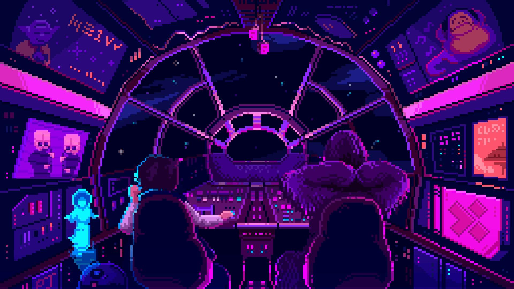

<!-- ══════════════════════════════════════════════════════════ -->
<!--  THIIZORD.EXE — dark retro gamer profile                   -->
<!-- ══════════════════════════════════════════════════════════ -->

<div align="center">



<a href="https://git.io/typing-svg">
  
</a>


</div>

---

```console
thiizord@arcade:~$ whoami
> Player detected: Thiago "Thiizord" Barbosa
> Location......: Curitiba, PR — Brazil

thiizord@arcade:~$ cat profile.txt
> Developer mode activated
> Studying code, building stuff and leveling up...
> Stack loaded: JavaScript · Python · HTML · CSS

thiizord@arcade:~$ git status
> On branch main — ready to commit new adventures
```

---

## 🎮 PLAYER PROFILE

| STAT        | VALUE                                                        |
| ----------- | ------------------------------------------------------------ |
| **PLAYER**  | Thiago "THIIZORD" Barbosa                                    |
| **CLASS**   | Code Explorer — estudando programação e subindo de nível     |
| **BASE**    | Curitiba, PR 🇧🇷                                               |
| **QUEST**   | Aprender desenvolvimento construindo projetos reais          |
| **LOADOUT** | `JavaScript` `Python` `HTML` `CSS`                           |
| **GUILD**   | [github.com/Thiizord](https://github.com/Thiizord)           |

---

## 🕹️ TECH STACK — INVENTORY

<div align="center">
  <a href="https://skillicons.dev">
    
  </a>
</div>

---

## 📊 STATS SCREEN

<div align="center">
  
  
</div>

<div align="center">
  
</div>

---

## 🐍 CONTRIBUTION ARCADE

<!-- Gerado automaticamente pela GitHub Action Platane/snk → branch `output`.
     Se a imagem não aparecer, rode a Action "Generate Snake" na aba Actions. -->
<picture>
  <source media="(prefers-color-scheme: dark)" srcset="https://raw.githubusercontent.com/Thiizord/Thiizord/output/github-snake-dark.svg"/>
  <source media="(prefers-color-scheme: light)" srcset="https://raw.githubusercontent.com/Thiizord/Thiizord/output/github-snake.svg"/>
  
</picture>

---

## 🗺️ SELECT YOUR QUEST

<div align="center">
  <a href="https://github.com/Thiizord/Planner-guild-run">
    
  </a>
</div>

> 🎯 **[Planner-guild-run](https://github.com/Thiizord/Planner-guild-run)** — Planner feito para o game **GuildRun**, para estudo de códigos. `JavaScript` `CSS` `Python` `HTML`

---

## 📡 CONNECT PLAYER

<div align="center">
  <a href="https://github.com/Thiizord">
    
  </a>
  <a href="https://x.com/Thiiago_Barboza">
    
  </a>
</div>

---

<div align="center">
  
</div>
